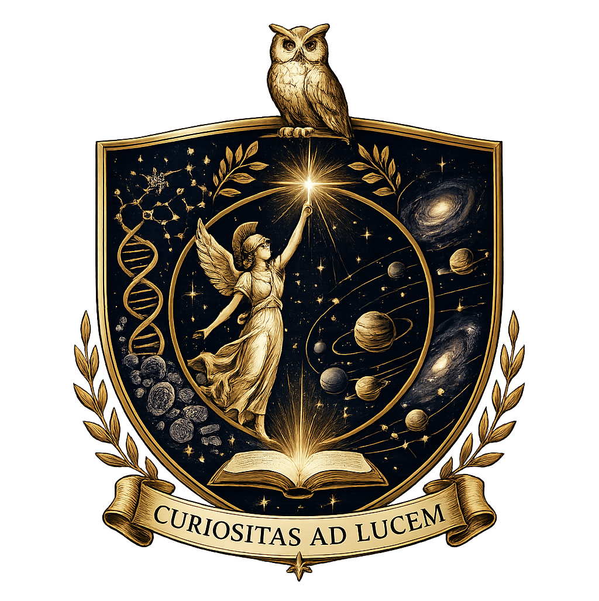

<div align="center">


<br>

# Sabrina Palis Jorgenson

### Independent Researcher · AI Systems & Data Specialist · Subject Matter Expert & Technical Educator

**Interdisciplinary Research · Scientific Computing · AI Systems & Evaluation · Technical Communication**

*MSc Artificial Intelligence — First Class Honours · MBA · Master in AI for Business · MA Education — Merit · PGCE/QTS*

[🇫🇷 Version française](README_FR.md)

[**Portfolio**](https://minervarose.github.io/) · [**ORCID**](https://orcid.org/0009-0009-4663-9778) · [**Medium**](https://medium.com/@sabrina.jorgenson) · [**LinkedIn**](https://www.linkedin.com/in/sabrina-jp/)


</div>

---

I explore **how AI, data, and computation can help us understand complex systems**, and where their assumptions and limitations matter. That inquiry takes different forms: computational experiments, decision-support systems, expert reviews, educational work, and writing.

My work brings together **applied AI, scientific computing, interdisciplinary research, and education**, informed by a background in languages and the humanities. Across these areas, I place particular importance on **evidence, uncertainty, auditability, reproducibility, explainability, and human judgement**.

My technical practice has developed continuously since 2017 through scholarships, nanodegrees, specialist programmes, independent projects, and postgraduate study. I use GitHub to document that ongoing exploration through reproducible experiments, technical reports, notebooks, research artefacts, and working software.

---

## ✦ Selected Technical Work

| Project | What it demonstrates |
| --- | --- |
| 🚀 [**Industry-Integrated AI Systems Synthesis**](https://github.com/MinervaRose/industry-integrated-ai-systems-synthesis) | Auditable AI decision support for aerospace anomaly triage, with explicit architecture, evaluation, documentation, and reproducible analysis |
| 📊 [**BeLedgerReady**](https://github.com/MinervaRose/BeLedgerReady) | Full-stack audit-readiness assistant combining deterministic analytics, explainable AI, human review, synthetic demo data, and documented safeguards |
| 🐦 [**bioacoustic-topology**](https://github.com/MinervaRose/bioacoustic-topology) | Computational bioacoustics using manifold learning, dynamical systems, motif structure, and scientific visualisation |
| 🪐 [**Exoplanet Discovery Observatory**](https://github.com/MinervaRose/exoplanet-discovery-observatory) | Scientific data exploration and Tableau visualisation using NASA Exoplanet Archive data |
| 🧩 [**Clues**](https://github.com/MinervaRose/clues) | Python package for evidence-oriented exception investigation, with tests, packaging, CI, and human-readable diagnostic reports |

These projects span **AI systems, scientific computing, analytics, visualisation, developer tooling, and decision support**. The common thread is a preference for systems whose reasoning, evidence, and limitations remain visible.

---

## ✦ Professional Practice

### AI Systems & Data
I design and evaluate applied AI and data workflows using Python, SQL, machine learning, LLM systems, analytics, dashboards, and decision-support logic.

### Research
I explore computational and conceptual approaches to scientific and technical questions, particularly where **structure, uncertainty, signals, anomalies, multimodal data, and visualisation** matter. I am as interested in the assumptions behind an analysis as in the patterns it reveals.

### Subject-Matter Expertise & Technical Review
Since July 2026, I have worked as a **Subject Matter Expert — AI & Data with Starweaver**, reviewing professional learning content for technical accuracy, clarity, and practical relevance. This work draws on both technical judgement and experience assessing how complex material is explained and applied.

### Technical Education
I teach and mentor across AI, data analysis, business intelligence, data science, machine learning, Python, SQL, and generative AI. My work includes curriculum development, project-based learning, technical feedback, and assessment.

### Certification & Evaluation
I serve as a **Generative AI Certification Juror & Evaluator**, assessing practical deliverables, technical reasoning, methodology, documentation, communication, and responsible AI practice.

---

## ✦ Research & Open Science

I am particularly interested in research artefacts that remain **inspectable, reproducible, and attributable**: repositories, notebooks, datasets, visualisations, technical reports, documented experiments, and versioned releases.

For new research and capstone releases, I use clear versioning and provenance, including **Zenodo and DOI records where appropriate**.

**ORCID:** [0009-0009-4663-9778](https://orcid.org/0009-0009-4663-9778)

Current and emerging interests include:

**scientific triage · signal and time-series analysis · multimodal data · anomaly detection · human–AI collaboration · scientific visualisation · decision support under uncertainty**

---

## ✦ Technical Foundations

```text
Languages & Development  Python • SQL • Jupyter • Git • GitHub
AI & Machine Learning     ML • Deep Learning • NLP • LLM Systems • Computer Vision
Data & Analytics          Tableau • Power BI • EDA • Data Visualization • KPI Design
Research                  Scientific Computing • Signal Analysis • Anomaly Detection
Systems                   Agentic Workflows • Human-in-the-Loop AI • Decision Support
```

My systems perspective was strongly shaped by autonomous driving, where perception, localisation, prediction, planning, and control must work together under uncertainty.

Earlier work in this field is collected in the [**Self-Driving Car Engineer portfolio**](https://github.com/MinervaRose/Self-Driving-Car-Engineer-Nanodegree-Projects).

---

## ✦ Technical Development, Scholarships & Nanodegrees

My route into AI has been **cumulative rather than sudden**.

Beginning with the **Google Developer Scholarship Challenge in 2017**, I pursued sustained technical development through project-based programmes, scholarships, nanodegrees, specialist study, and self-directed work.

<details>
<summary><strong>Selected programmes, nanodegrees & scholarships</strong></summary>

<br>

- Google Developer Scholarship Challenge
- Facebook AI Scholarship
- Bertelsmann Data Science Scholarship
- Self-Driving Car Engineer Nanodegree
- Deep Learning Nanodegree
- Generative AI Nanodegree
- AWS technical training and cloud foundations
- Continued specialist study across computer vision, reinforcement learning, data science, scientific computing, Spark/Databricks, and modern AI tooling

</details>

That progression eventually led to an **MSc in Artificial Intelligence with First Class Honours**.

---

## ✦ Academic Background

My formal studies span **languages and literature, education, management, and artificial intelligence**. They reflect different stages of a continuing intellectual journey, rather than a single disciplinary track.

- **MSc Artificial Intelligence — First Class Honours** · 2026
- **MBA — Management, Marketing & Data** · 2025
- **Master in AI for Business** · 2025
- **MA Education — Merit** · 2014
- **PGCE Modern Foreign Languages with QTS** · 2011
- **BA English Language & Literature (LLCE)** · 2002

---

## ✦ Selected Writing

I write about AI, scientific reasoning, mathematics, representation, language, and the limits of what our systems allow us to know.

- [**Perhaps AI Has Been Defined at the Wrong Scale**](https://medium.com/@sabrina.jorgenson/perhaps-ai-has-been-defined-at-the-wrong-scale-7e07da2e8318)
- [**When Correct Answers Make Us Know Less**](https://medium.com/@sabrina.jorgenson/when-correct-answers-make-us-know-less-8d67d407d932)
- [**The Human Was in the Loop. Was There Enough Time?**](https://medium.com/@sabrina.jorgenson/the-human-was-in-the-loop-was-there-enough-time-aa388bb71afc)
- [**What Comes Before Symmetry?**](https://medium.com/@sabrina.jorgenson/what-comes-before-symmetry-557bb2e1a70b)
- [**The World Is Not Made of Things**](https://medium.com/@sabrina.jorgenson/the-world-is-not-made-of-things-a486eb9b84c2)
- [**AI Narrans**](https://medium.com/@sabrina.jorgenson/ai-narrans-bc4ed5239ce6)

[**More writing on Medium →**](https://medium.com/@sabrina.jorgenson)

---

## ✦ How I Work

**Evidence before claims · Reproducibility where it matters · Uncertainty made visible · Human judgement remains central**

I am most interested in work where computation does more than automate a task: where it helps people **inspect evidence, see structure, test assumptions, understand uncertainty, or make better decisions**.

---

## ✦ Beyond the Code

I entered technology through **education, languages, and the humanities rather than a conventional engineering pathway**. Technical study expanded that background rather than replacing it.

Literature, language, music, and a persistent fascination with space continue to influence the questions I explore, even when the result takes the form of a technical system.

<div align="center">



### ✦ Curiositas ad Lucem ✦

</div>
