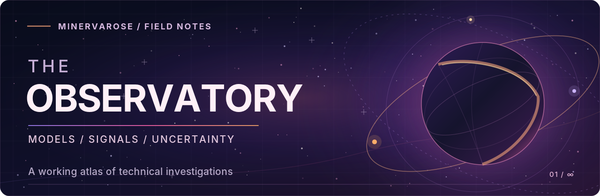
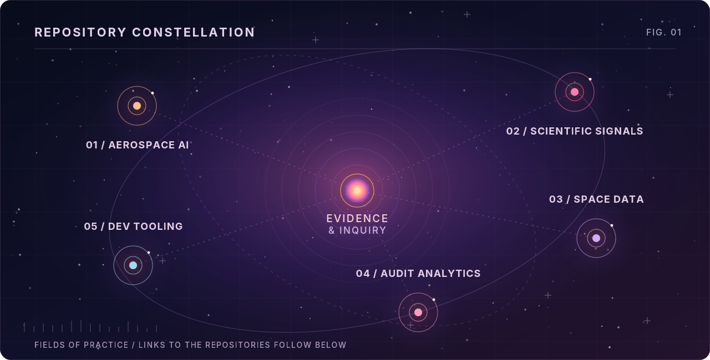

<div align="center">

<picture>
  <source media="(max-width: 600px)" srcset="assets/observatory-banner-mobile.png">
  
</picture>

**Sabrina Palis** · AI Systems & Data Specialist · Independent Researcher

[Explore the portfolio](https://minervarose.github.io/) &nbsp;·&nbsp; [Français](README_FR.md) &nbsp;·&nbsp; [ORCID](https://orcid.org/0009-0009-4663-9778) &nbsp;·&nbsp; [Get in touch](https://www.linkedin.com/in/sabrina-jp/)

</div>

### Welcome to the Observatory

My work is rooted in artificial intelligence and data science, but my curiosity has never been confined to a single discipline.

I enjoy exploring unfamiliar questions, experimenting with ideas and building things along the way. Some become substantial projects; others are smaller investigations, prototypes or simply things I wanted to try.

This is where I share a selection of those explorations. My [portfolio](https://minervarose.github.io/) tells the broader professional story. Here, you can open the repositories and discover the work for yourself.

### On the observing desk

Five projects, five different starting points. Follow whichever catches your interest.

### Repository constellation

<picture>
  <source media="(max-width: 600px)" srcset="assets/repository-constellation-mobile.png">
  
</picture>

- **01 / Aerospace AI** · [Industry-Integrated AI Systems Synthesis](https://github.com/MinervaRose/industry-integrated-ai-systems-synthesis)  
  Anomaly triage, auditable decision-support architecture and human oversight.
- **02 / Scientific signals** · [Bioacoustic Topology](https://github.com/MinervaRose/bioacoustic-topology)  
  Birdsong features, manifold representations, motif structure and dynamical perspectives.
- **03 / Space data** · [Exoplanet Discovery Observatory](https://github.com/MinervaRose/exoplanet-discovery-observatory)  
  Data exploration and Tableau visualisation using NASA Exoplanet Archive data.
- **04 / Audit analytics** · [BeLedgerReady](https://github.com/MinervaRose/BeLedgerReady)  
  Deterministic checks, explainable assistance and evidence-oriented financial review.
- **05 / Developer tooling** · [Clues](https://github.com/MinervaRose/clues)  
  Evidence-oriented exception investigation in Python, with tests and diagnostic reports.

### How I work

```text
OBSERVE    Python · SQL · Jupyter · exploratory analysis
MODEL      Machine learning · LLM systems · signal representations
EXAMINE    Evaluation · traceability · human review · limitations
DOCUMENT   Reproducible notebooks · technical reports · versioned artefacts
```

Experiments and prototypes are labelled as such. A promising representation is a starting point for investigation, not automatically a scientific conclusion.

---

<div align="center">

*Curiositas ad Lucem*

[Portfolio](https://minervarose.github.io/) · [Writing](https://medium.com/@sabrina.jorgenson) · [ORCID](https://orcid.org/0009-0009-4663-9778) · [LinkedIn](https://www.linkedin.com/in/sabrina-jp/)

</div>
