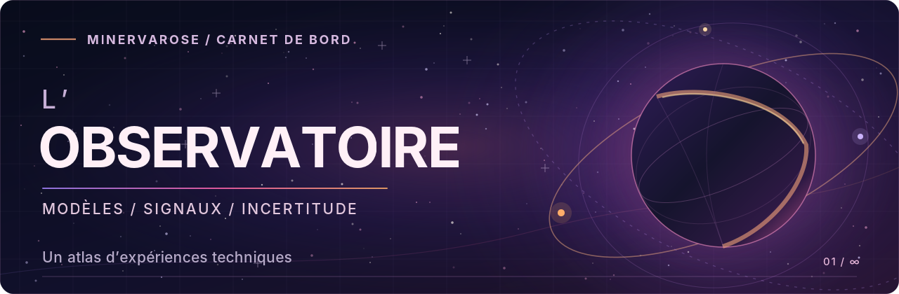
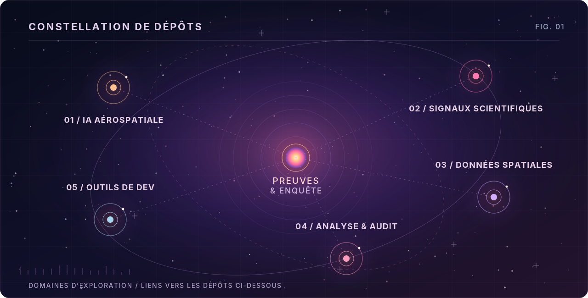

<div align="center">

<picture>
  <source media="(max-width: 600px)" srcset="assets/observatory-banner-mobile-fr.png">
  
</picture>

**Sabrina Palis** · Explorations techniques indépendantes en IA et données scientifiques

[Découvrir le portfolio](https://minervarose.github.io/fr/) &nbsp;·&nbsp; [English](README.md) &nbsp;·&nbsp; [ORCID](https://orcid.org/0009-0009-4663-9778) &nbsp;·&nbsp; [Me contacter](https://www.linkedin.com/in/sabrina-jp/)

</div>

### Un carnet de questions en cours d'exploration

J'utilise cet espace pour rendre mes investigations techniques examinables. On y trouve du code, des notebooks, des prototypes, des visualisations, des artefacts de recherche et les décisions qui les accompagnent. Je m'intéresse à ce que les modèles et les données peuvent révéler, mais aussi aux conclusions que les preuves ne permettent pas de tirer.

Le [portfolio](https://minervarose.github.io/fr/) présente mon parcours et mes activités professionnelles. Cet observatoire donne accès aux expérimentations elles-mêmes.

### Sur la table d'observation

**Systèmes d'aide à la décision.** Comment traiter les preuves, l'incertitude et les mécanismes d'escalade lorsque des composants analytiques participent à des décisions sensibles ?

**Structure des signaux scientifiques.** Que révèlent différentes représentations des motifs acoustiques, des trajectoires et des anomalies ? À quel moment risquent-elles de nous induire en erreur ?

**Investigations traçables.** Comment préserver le chemin qui mène d'une observation à une interprétation, au lieu de ne présenter qu'une réponse finale ?

### Constellation de dépôts

<picture>
  <source media="(max-width: 600px)" srcset="assets/repository-constellation-mobile-fr.png">
  
</picture>

Une sélection de projets publics. Chacun explore une question particulière, avec ses méthodes et ses limites.

- **01 / IA aérospatiale** · [Industry-Integrated AI Systems Synthesis](https://github.com/MinervaRose/industry-integrated-ai-systems-synthesis)  
  Triage d'anomalies, architecture d'aide à la décision auditable et supervision humaine.
- **02 / Signaux scientifiques** · [Bioacoustic Topology](https://github.com/MinervaRose/bioacoustic-topology)  
  Caractéristiques du chant d'oiseau, représentations de variétés, motifs et dynamique des signaux.
- **03 / Données spatiales** · [Exoplanet Discovery Observatory](https://github.com/MinervaRose/exoplanet-discovery-observatory)  
  Exploration et visualisation Tableau de données issues de la NASA Exoplanet Archive.
- **04 / Analyse et audit** · [BeLedgerReady](https://github.com/MinervaRose/BeLedgerReady)  
  Contrôles déterministes, assistance explicable et examen financier fondé sur les preuves.
- **05 / Outils de développement** · [Clues](https://github.com/MinervaRose/clues)  
  Analyse d'exceptions Python orientée preuves, avec tests et rapports de diagnostic.

### Ma manière de travailler

```text
OBSERVER    Python · SQL · Jupyter · analyse exploratoire
MODÉLISER   Machine learning · systèmes LLM · représentations de signaux
EXAMINER    Évaluation · traçabilité · contrôle humain · limites
DOCUMENTER  Notebooks reproductibles · rapports · artefacts versionnés
```

Les expériences et prototypes sont présentés comme tels. Une représentation prometteuse constitue une piste d'investigation, pas nécessairement une conclusion scientifique.

<details>
<summary><b>Afficher la trace des contributions</b> · activité GitHub en direct</summary>

<br>


<sub>Ce graphique facultatif provient d'un service tiers et peut parfois être indisponible. Aucun workflow GitHub Actions n'est nécessaire.</sub>

</details>

---

<div align="center">

*Curiositas ad Lucem*

[Portfolio](https://minervarose.github.io/fr/) · [Articles](https://medium.com/@sabrina.jorgenson) · [ORCID](https://orcid.org/0009-0009-4663-9778) · [LinkedIn](https://www.linkedin.com/in/sabrina-jp/)

</div>
